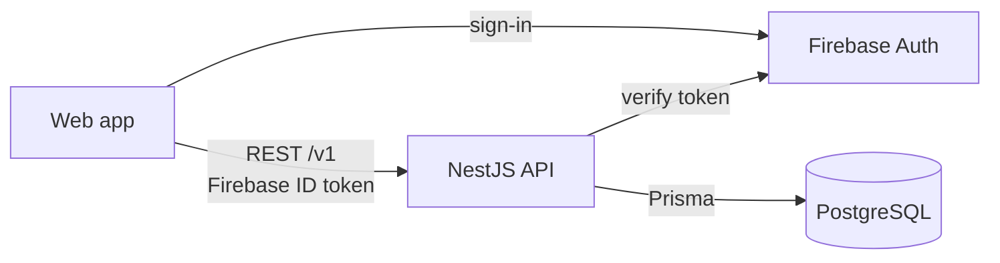

# Solde API

Backend of **Solde**, a personal finance app: a monthly budget, debts between friends, savings in bank and cash, and vehicles bought together. You enter something once and every page that depends on it updates.

## Demo

<!-- Paste the GitHub video link here: drag the video into the editor on github.com. -->

Web app (React): [voit-admin](https://github.com/Voit-admin/voit-admin)

## Architecture



Inside the API: NestJS, Domain-Driven Design and CQRS.

```
write: HTTP controller → CommandBus → service → domain entity → repository → domain events
read:  HTTP controller → QueryBus → query handler → Prisma
```

Modules (`src/modules`): `monthly-budget`, `recurring-charge`, `debt`, `savings`, `contact`, `vehicle`, `user`, `wallet`, `auth`. They talk through domain events, or by dispatching another module's command: adding a vehicle expense creates its debts this way. The import rules between layers are checked by `npm run deps:validate` ([dependency-cruiser](.dependency-cruiser.js)).

## Key decisions

| Decision | Why |
|---|---|
| [Recurring charges are versioned](prisma/schema.prisma): each edit adds a version, and a [generated month](src/modules/monthly-budget/commands/init-month/init-month.service.ts) keeps pointing to the version that was current | Changing a charge never rewrites the months already generated |
| [Money is an integer in cents](src/libs/money/money.ts), handled with Dinero.js | No rounding error |
| [Savings are computed, never stored](src/modules/savings/savings-engine.service.ts): the balances and the history are rebuilt from six sources (lent debts, repayments, budget withdrawals, manual movements, vehicle expenses, vehicle sales) | One entry feeds every page, so nothing is typed twice. Borrowed money never counts as savings. |
| [A debt's status is derived](src/modules/debt/domain/debt.entity.ts) from its repayments, with two explicit overrides: settled by hand or forgiven | The status cannot disagree with the repayments |
| A [vehicle sale](src/modules/vehicle/commands/declare-sale/declare-sale.service.ts) splits the profit by share and creates the debts between the beneficiaries. An expense paid [on behalf of someone](src/modules/vehicle/domain/profit-sharing.ts) counts as their investment and creates a debt | Handlers that write several tables run in one transaction, so a sale or an expense is never half recorded |
| [Contacts are hidden, not deleted](src/modules/contact/database/contact.repository.ts) when they have history | A debt, an expense payment or a sale cannot lose the person it refers to |
| [Firebase Auth](src/modules/auth/firebase-auth.guard.ts) behind a global guard, and the [Auth Emulator](src/modules/auth/firebase-admin.service.ts) for development and tests | No real credentials needed to run it locally |

## What it does

- **Monthly budget:** enter the salary, the active recurring charges are applied, and the remaining amount can be set aside into savings.
- **Recurring charges:** create, edit (versioned), deactivate and reactivate.
- **Debts:** loans and borrowings with a contact, paid from bank, cash or both. Repayments, partial or full, mark as settled or forgive.
- **Contacts:** the people you share money with.
- **Vehicles:** several owners with a profit share each, expenses with several payers, free-form notes, and a sale.
- **Savings:** bank and cash balances, the full history of what moved them, and manual movements.

Swagger lists every route at `/docs`.

## Run it locally

You need Node.js 20, Docker and the Firebase CLI. Run each long command in its own terminal.

```bash
npm install
cp .env.example .env     # see src/configs/env.validation.ts
npm run docker:env       # PostgreSQL on 5433, pgAdmin on 5051
npm run migration:deploy
npm run prisma:generate
npm run firebase:emulator
npm run start:dev        # http://localhost:3000, Swagger at /docs
npm run db:seed          # demo data, created through the running API
```

Set `FIREBASE_AUTH_EMULATOR_HOST="127.0.0.1:9099"` in `.env` to use the emulator: the other `FIREBASE_*` values can then be placeholders. The seed prints the account to sign in with. The app validates its environment at boot and refuses to start if a variable is missing.

## What I'd improve

- Automated tests: the end-to-end setup is there (Gherkin features, a real PostgreSQL, the Auth Emulator) but the business modules have no tests yet. The rules sit in domain entities, so they can be tested without a database.
- Account creation: accounts come from the seed, there is no sign-up flow yet.
- Template leftovers: the packages nothing uses any more (`@nestjs/jwt`, GraphQL).

## Contact

